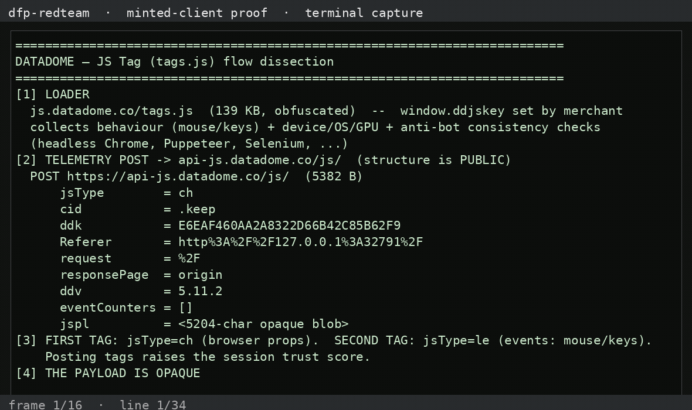

# dfp-redteam-datadome — DataDome JS Tag

Authorized dissection of DataDome's **client** JS Tag (`js.datadome.co/tags.js`)
using a merchant's **public** client-side key (vinted.fr's `DATADOME_CLIENT_SIDE_KEY`,
read from their page HTML). Only public page loads; no protected endpoint hit.
Detail: [`DATADOME_BREAK_2026_11_02.md`](DATADOME_BREAK_2026_11_02.md).

---

## What we found

- **Loader**: `js.datadome.co/tags.js` (139 KB, obfuscated), keyed by the
  merchant's `window.ddjskey`. It hooks mouse/keyboard, device/OS/GPU properties,
  and runs **anti-bot consistency checks** (headless Chrome, Puppeteer, Selenium…).
- **Telemetry** is POSTed to `api-js.datadome.co/js/` — the **endpoint and key
  are public**. Body fields: `jspl` (5.2 KB opaque blob), `jsType=ch` (browser
  props; a second `le` tag carries events), `cid`, `ddk=<key>`, `Referer`,
  `request`, `responsePage`, `ddv=5.11.2`.
- **The `jspl` payload is opaque**: it base64-decodes to high-entropy binary — a
  **custom-encoded telemetry blob** (device + behaviour + proofs-of-work). No
  static client key was found; the server decodes it. **We did not invert it.**
- **The server owns the session**: responses are `{"status":200}` and a
  server-issued **`datadome` cookie** is set on real merchant contexts (the
  device-session token). DataDome's invisible **Device Check** enforces
  per-request proofs-of-work server-side.

## Status

- 🟢 Read flow / endpoint / key / structure: fully characterised
- 🔴 Read `jspl` payload: opaque custom encoding — **not inverted**
- 🔴 Mint session: the `datadome` cookie + Device Check are **server-issued**
  — not client-mintable
- The moat is server-side (detection engine + Device Check PoW) and the
  telemetry encoding is opaque

## Recorded demo

<video src="assets/demo-datadome.mp4" width="720" controls></video>

## Artifacts & scripts

- [`artifacts/cap-result.json`](artifacts/cap-result.json) — full tags POST + response
- `scripts/dd-capture.mjs` — drive the real tags.js + capture the telemetry POST
- `scripts/demo-datadome.py` — print the analysis

## Honest caveats

- Used a merchant's **public** client-side key only; no protected resource was
  requested and no session cookie was forged or replayed.
- The `jspl` encoding was **not** broken — we characterise the envelope, not the
  contents.
- Good-vs-bad framing: a **good** design — public key/endpoint like everyone, but
  the telemetry is opaque and the session + challenge are server-side.
